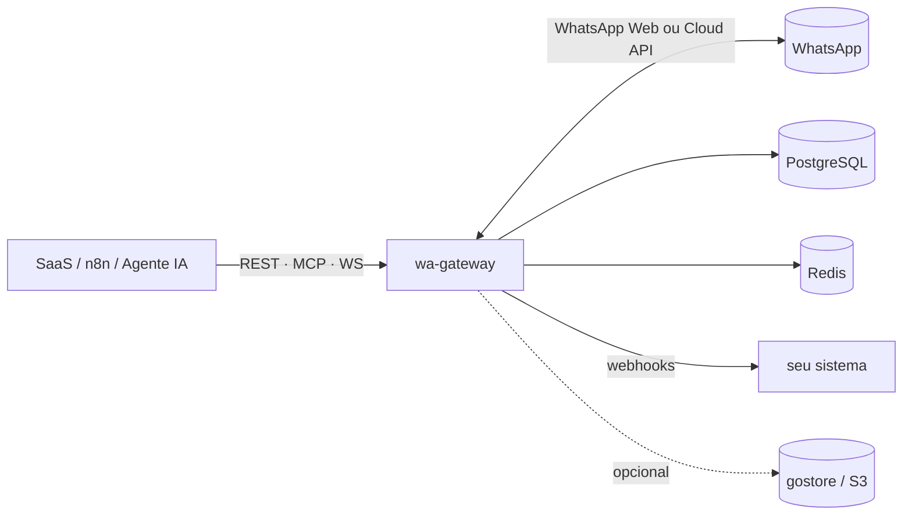

<div align="center">

# wa-gateway

**API de WhatsApp gratuita e open source, em Go.**
Multi-sessão, multi-tenant, com webhooks, console web, node para n8n e servidor MCP para agentes de IA.

*Free, open-source, self-hosted WhatsApp HTTP API written in Go — a lightweight alternative to Evolution API and WAHA.*

[](https://github.com/fdsriopreto-code/wa-gateway/actions/workflows/ci.yml)
[](go.mod)
[](LICENSE)
[](#contribuindo)

[Começo rápido](#-começo-rápido) · [Recursos](#-recursos) · [Integrações](#-integrações) · [Endpoints](#-endpoints) · [Documentação](#-documentação) · [English](#-in-english)

</div>

---

## Por que o wa-gateway?

- 🪶 **Um binário só.** Go puro, console web embutido, sem Node, sem build de frontend. Sobe com `docker compose up`.
- 📱 **Vários números no mesmo servidor.** Cada sessão é um WhatsApp; centenas por máquina, e cluster com vários nós quando precisar.
- 🏢 **Pronto para SaaS.** Chave de API por cliente, isolada na sessão dele, com proteção contra SSRF e segredos cifrados no banco.
- 🔌 **Fácil de integrar.** REST + OpenAPI/Swagger, webhooks com HMAC e retry, WebSocket, node oficial para **n8n** e **MCP** para agentes de IA.
- 🔁 **Dois motores, a mesma API.** WhatsApp Web (multi-device, via QR ou código) ou a **Cloud API oficial da Meta**: troca na config, sem mudar a integração.
- 💸 **Gratuito para sempre.** Licença MIT: use, modifique e venda o seu produto em cima.

> [!WARNING]
> O motor padrão usa o protocolo do WhatsApp Web (biblioteca [whatsmeow](https://github.com/tulir/whatsmeow)), que **não é oficial**.
> Este projeto não tem vínculo com o WhatsApp nem com a Meta. Uso abusivo (spam, disparo em massa frio) pode levar ao **bloqueio do número**.
> Se o número não pode cair de jeito nenhum, use o motor [Cloud API oficial](docs/CLOUD.md).

## 🚀 Começo rápido

Precisa só de **Docker**.

```bash
git clone https://github.com/fdsriopreto-code/wa-gateway.git
cd wa-gateway
docker compose up -d --build
```

Abra **http://localhost:3000**, cole a chave `dev-master-key` em **Conexão**, crie uma sessão e escaneie o QR code com o celular (WhatsApp → Aparelhos conectados).

Ou pela API:

```bash
KEY=dev-master-key
BASE=http://localhost:3000

# 1. cria e inicia a sessão (com webhook)
curl -s -XPOST $BASE/api/sessions -H "X-Api-Key: $KEY" -H 'content-type: application/json' \
  -d '{"name":"default","start":true,
       "config":{"webhooks":[{"url":"https://webhook.site/xxxx","events":["message"]}]}}'

# 2. QR code em imagem (abra no navegador) — ou /api/default/auth/qr em texto
echo "$BASE/api/default/auth/qr.png?api_key=$KEY"

# 3. envia uma mensagem
curl -s -XPOST $BASE/api/sendText -H "X-Api-Key: $KEY" -H 'content-type: application/json' \
  -d '{"session":"default","chatId":"5511999999999@s.whatsapp.net","text":"Olá do wa-gateway 👋"}'
```

> [!IMPORTANT]
> Em produção troque a `API_KEY`, defina `SECRET_KEY` (`openssl rand -hex 32`) e veja todas as opções em [`.env.example`](.env.example).

## ✨ Recursos

<table>
<tr><td valign="top" width="50%">

**Mensagens**
- Texto, imagem, vídeo, áudio / nota de voz, documento, sticker
- Localização, contato, enquete, reação
- Responder, mencionar, link preview, encaminhar
- Editar, apagar, marcar como lida, "digitando…"
- Envio por **URL** ou base64
- Botões / listas / templates (motor Cloud API)

**Sessões**
- Multi-sessão no mesmo processo
- Pareamento por **QR** ou **código de 8 dígitos**
- Reconexão automática, vigia de sessão travada
- Monitor de saúde (`session.unhealthy`)
- Perfil, recado, presença, bloqueio

**Grupos e contatos**
- Criar, entrar por link, sair, participantes, admins
- Nome, descrição, foto, só-admins
- Checar número, info e foto de perfil
- Etiquetas (WhatsApp Business)

</td><td valign="top" width="50%">

**Integração**
- REST + **OpenAPI 3** + Swagger UI (`/docs`)
- **Webhooks** com HMAC-SHA256, retry e reenvio manual
- **WebSocket** com eventos em tempo real
- **Idempotência** (`Idempotency-Key`)
- Callback de status por mensagem (`callbackUrl`)
- Node para **n8n** e servidor **MCP** (32 ferramentas)

**Recursos prontos**
- **Fila anti-ban**: intervalo, jitter e limite diário por sessão
- **Resposta automática** (horário comercial, palavras-chave)
- **OTP**: envio e verificação de código
- **CRM / Leads**: origem do contato (anúncio, UTM, click ids)
- Histórico de chats e mensagens no Postgres
- Mídia no [gostore](https://github.com/fdsriopreto-code/gostore-s3) ou qualquer S3 (AWS, R2, MinIO) com TTL
- Transcrição de áudio e descrição de imagem (IA)

**Produção**
- Chaves de API com escopo por sessão (Argon2id)
- Anti-SSRF, segredos cifrados (AES-256-GCM), rate limit
- Cluster com roteamento entre nós e failover
- Proxy por sessão, métricas Prometheus, logs estruturados

</td></tr>
</table>

## 🔌 Integrações

### n8n

Node comunitário **`n8n-nodes-wa-gateway`** em [`clients/n8n`](clients/n8n): operações em dropdown, conversão de binário automática e um **Trigger** que registra o webhook sozinho ao ativar o workflow. Também funciona com o node **HTTP Request** + **Webhook** do n8n.

### Agentes de IA (MCP)

`POST /mcp` fala **Model Context Protocol**: conecte Claude, Cursor ou qualquer agente MCP e ele passa a ler e responder WhatsApp com 32 ferramentas (sessões, envio, contatos, grupos, histórico, leads, OTP…). Guia em [docs/MCP.md](docs/MCP.md).

### Webhooks e eventos

Toda ação do WhatsApp vira um evento `domínio.ação` (`message`, `message.ack`, `session.status`, `group.*`…), com assinatura por wildcard (`message.*`, `*`). Entrega durável com retry; payload enxuto e normalizado:

```json
{
  "id": "A5010C563B75F82E469274B2B0606F5C",
  "chatId": "5511999999999@s.whatsapp.net",
  "from": "5511999999999@s.whatsapp.net",
  "fromMe": false,
  "pushName": "Maria",
  "type": "text",
  "timestamp": 1756499088,
  "body": "Oi, tudo bem?"
}
```

- **`message`**: só as recebidas (o que um bot assina) · **`message.any`**: todas · **`message.ack`**: entregue / lida / ouvida.
- Endereços `@lid` são resolvidos para o telefone quando possível. O struct cru do whatsmeow só vem com `config.rawEvents: true`.
- Com mídia guardada em S3, o evento ganha `media: {id, url, mimetype, size}`; com IA ligada, `transcript` / `imageCaption`.

### SaaS multi-tenant

Uma chave de API por cliente (`scopes: ["session:cliente-42"]`) só enxerga a sessão dele, não alcança a rede interna e não dispara campanha. Dimensionamento, cluster e anti-ban em [docs/MULTITENANT.md](docs/MULTITENANT.md).

## 📡 Endpoints

Autenticação: header `X-Api-Key` (ou `Authorization: Bearer`). O corpo dos envios sempre inclui `session`; `chatId` no formato `55...@s.whatsapp.net` ou `...@g.us`. A referência completa e interativa fica em **`/docs`** (Swagger).

<details>
<summary><b>Ver tabela de endpoints</b></summary>

| Método | Rota | Uso |
|---|---|---|
| POST | `/api/sessions` | criar sessão (`name`, `config?`, `start?`) |
| GET / PUT / DELETE | `/api/sessions/{session}` | ver / atualizar config / apagar |
| POST | `/api/sessions/{session}/start` \| `/stop` \| `/logout` \| `/restart` | ciclo de vida |
| GET | `/api/{session}/auth/qr` \| `/auth/qr.png` | QR code (texto ou imagem) |
| POST | `/api/sessions/{session}/webhook/test` | dispara um `webhook.test` para validar o receptor |
| POST | `/api/sendText` | `chatId, text, quotedId?, quotedParticipant?, mentions[]?, linkPreview?` |
| POST | `/api/sendImage` \| `/api/sendFile` \| `/api/sendVideo` \| `/api/sendAudio` | `chatId, data, mimetype?, caption?, filename?, seconds?, gif?, voice?, quotedId?, mentions[]?` |
| POST | `/api/sendSticker` | `chatId, data` (base64 `.webp`) |
| POST | `/api/sendLocation` | `chatId, latitude, longitude, name?, address?` |
| POST | `/api/sendContact` | `chatId, contacts:[{name, phone?\|vcard?}]` |
| POST | `/api/sendPoll` | `chatId, name, options[] (≥2), selectable?` |
| POST | `/api/reaction` | `chatId, messageId, fromMe?, senderId?, emoji` (`""` remove) |
| POST | `/api/deleteMessage` | `chatId, messageId, fromMe?, senderId?` |
| POST | `/api/editMessage` | `chatId, messageId, text` |
| POST | `/api/sendSeen` | `chatId, messageId, fromMe?, senderId?` |
| POST | `/api/presence` | `chatId, state` (`typing`\|`recording`\|`paused`) |
| POST | `/api/sessions/{session}/auth/pair-code` | `phone` → devolve código de 8 dígitos (parear **sem QR**) |
| GET | `/api/{session}/me` | — (JID, LID, pushName, plataforma, devices) |
| PUT | `/api/{session}/profile/status` | `status` (meu recado) |
| POST | `/api/{session}/presence` | `available` (online/offline global) |
| GET | `/api/{session}/blocklist` · POST `/api/{session}/block` | `{jid, block}` |
| GET | `/api/contacts/check?session=&phone=` | — (aceita `phone` repetido ou lista com vírgula) |
| GET | `/api/contacts/info?session=&jid=` | — |
| GET | `/api/contacts/profile-picture?session=&jid=&preview=` | — |
| GET | `/api/groups?session=` | — |
| POST | `/api/groups` | `name, participants[]` |
| POST | `/api/groups/join` | `code` |
| GET | `/api/groups/{jid}?session=` | — |
| POST | `/api/groups/{jid}/leave` | — |
| POST | `/api/groups/{jid}/participants` | `action, participants[]` |
| PUT | `/api/groups/{jid}/name` \| `/topic` | `name` \| `topic` |
| PUT | `/api/groups/{jid}/photo` | `data` (base64 jpeg) |
| PUT | `/api/groups/{jid}/announce` \| `/locked` | `enabled` (só admins enviam / editam) |
| GET | `/api/groups/{jid}/invite-link?session=&reset=` | — |
| GET | `/api/outbox?session=&limit=` | lista os jobs da fila de saída |
| GET | `/api/media/{id}?redirect=` | stream do binário (ou 302 pra URL assinada) |
| GET | `/api/chats?session=&limit=` | conversas guardadas (histórico) |
| GET | `/api/chats/{chatId}/messages?session=&limit=&before=` | histórico de uma conversa |
| GET | `/api/messages/{id}/download?session=` | baixa a mídia de uma mensagem guardada |
| POST | `/api/forwardMessage` | `{session, toChatId, messageId}` — encaminha (marca como encaminhada) |

</details>

### Fila anti-ban

Qualquer envio aceita `"enqueue": true` (e `"delay": "30s"`). Em vez de enviar na hora, o gateway espaça os envios da sessão por intervalo mínimo + atraso aleatório, mantendo a ordem, com limite diário opcional. Ajuste por sessão em `config.outbox`:

```json
{"outbox": {"minIntervalMs": 8000, "jitterMs": 4000, "dailyLimit": 800}}
```

### Mídia com o gostore

Fotos, áudios e documentos recebidos podem ser guardados automaticamente num storage S3-compatível. O par recomendado é o **[gostore](https://github.com/fdsriopreto-code/gostore-s3)**: servidor S3 em Go, um binário, sem banco, licença Apache 2.0. Qualquer outro S3 (AWS, Cloudflare R2, MinIO) também funciona.

```bash
docker compose --profile media up -d   # sobe o gostore junto (console em :9001)
```

```env
MEDIA_BACKEND=s3
S3_ENDPOINT=gostore:9000
S3_BUCKET=wa-media            # criado sozinho no primeiro uso
S3_ACCESS_KEY=gostoreadmin
S3_SECRET_KEY=troque-esta-senha-forte
S3_USE_SSL=false
S3_PATH_STYLE=true
```

Com isso o evento `message` ganha `media: {id, url, mimetype, size}`, `GET /api/media/{id}` serve o arquivo (ou um link assinado com `?redirect=true`) e `MEDIA_TTL` apaga as mídias antigas sozinho.

## 📚 Documentação

| Doc | Conteúdo |
|---|---|
| [ARCHITECTURE.md](docs/ARCHITECTURE.md) | pacotes, fluxo de envio e recebimento, cluster, **todas as variáveis de ambiente** |
| [MULTITENANT.md](docs/MULTITENANT.md) | SaaS: isolamento por cliente, dimensionamento, anti-ban (proxy, "digitando…") |
| [MCP.md](docs/MCP.md) | servidor MCP para agentes de IA |
| [CLOUD.md](docs/CLOUD.md) | motor Cloud API oficial da Meta: setup, webhook, botões, listas, templates |
| [OTP.md](docs/OTP.md) | código de verificação de número (`send` / `verify`) |
| [CRM.md](docs/CRM.md) | leads e origem do contato (anúncio Click-to-WhatsApp, UTM, click ids) |
| [ROADMAP.md](docs/ROADMAP.md) | o que já roda, o que falta e o que não vale a pena |
| [clients/n8n](clients/n8n/README.md) | node comunitário do n8n |

## 🏗️ Arquitetura



**Stack:** Go · [whatsmeow](https://github.com/tulir/whatsmeow) · PostgreSQL (fonte da verdade) · Redis (locks, filas, stream de eventos, pub/sub) · [chi](https://github.com/go-chi/chi) · [asynq](https://github.com/hibiken/asynq).

<details>
<summary><b>Estrutura de pastas</b></summary>

```
cmd/wa-gateway          entrypoint, wiring e shutdown
internal/engine         interface Engine + motores whatsmeow e cloud
internal/session        ciclo de vida das sessões, posse por lock, cluster
internal/httpapi        REST, MCP, OpenAPI, console web
internal/webhook        envelope, HMAC, entrega com retry
internal/events         barramento in-process + Redis Stream durável
internal/outbox         fila de saída anti-ban
internal/netguard       proteção anti-SSRF das chamadas de saída
internal/...            auth, store, cache, media, leads, otp, autoreply, ws
migrations              SQL (goose, embarcado)
clients/n8n             node comunitário do n8n
```

</details>

## 🛠️ Desenvolvimento

```bash
docker compose up -d postgres redis
cp .env.example .env
set -a && . ./.env && set +a
go run ./cmd/wa-gateway

go test ./...     # testes
go vet ./...      # análise estática
```

## Contribuindo

Contribuições são muito bem-vindas: issues com bug ou ideia, PRs de correção, docs ou recurso novo.

1. Faça um fork e crie uma branch.
2. Rode `gofmt`, `go vet ./...` e `go test ./...` (o CI roda os mesmos).
3. Abra o PR explicando o porquê da mudança.

Para estender (endpoint novo, ferramenta MCP, motor novo), veja [ARCHITECTURE.md §10](docs/ARCHITECTURE.md#10-como-estender).

Se o projeto te ajudou, **deixe uma ⭐**: é o que faz mais gente encontrar.

## Licença

[MIT](LICENSE): gratuito para uso pessoal e comercial.

O motor padrão depende do [whatsmeow](https://github.com/tulir/whatsmeow) (MPL-2.0). WhatsApp é marca da Meta Platforms, Inc.; este projeto não é afiliado, endossado nem patrocinado por ela.

---

## 🌎 In English

**wa-gateway** is a free, open-source, self-hosted **WhatsApp HTTP API** written in Go — a lightweight alternative to Evolution API and WAHA.

- Multi-session (many WhatsApp numbers per server), multi-tenant API keys scoped per session
- Two engines behind one API: WhatsApp Web multi-device (via [whatsmeow](https://github.com/tulir/whatsmeow), QR or pairing code) and the **official Meta Cloud API**
- REST + OpenAPI/Swagger, signed webhooks with retries, WebSocket events, idempotency
- **n8n community node** and a built-in **MCP server** for AI agents
- Anti-ban outbound queue, per-session proxy, typing simulation, auto-reply, OTP, lead/CRM tracking
- Media storage on [gostore](https://github.com/fdsriopreto-code/gostore-s3) or any S3-compatible service, AI audio transcription & image captioning
- Single static binary with an embedded web console; PostgreSQL + Redis; horizontal clustering with failover

Quick start: `docker compose up -d --build`, open http://localhost:3000, use API key `dev-master-key`, scan the QR code. Docs are in Portuguese under [`docs/`](docs); the API reference is served at `/docs`.

> Not affiliated with WhatsApp or Meta. The default engine uses an unofficial protocol — abusive use may get numbers banned.
